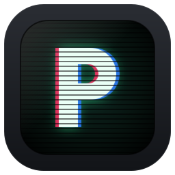
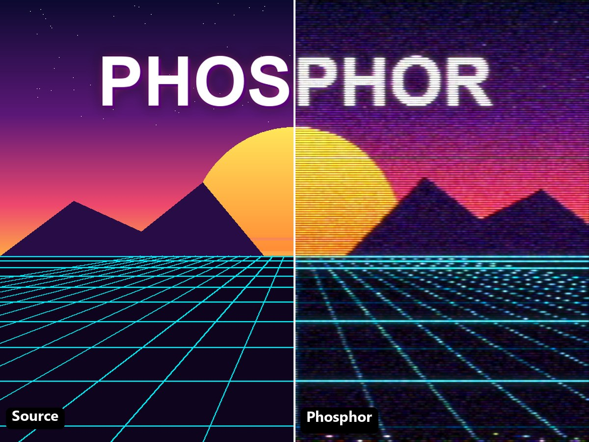
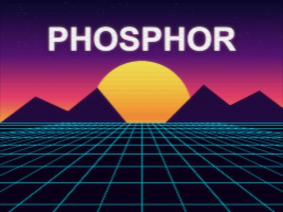
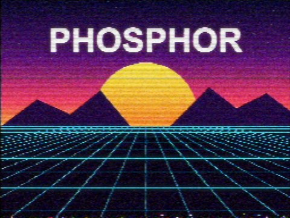
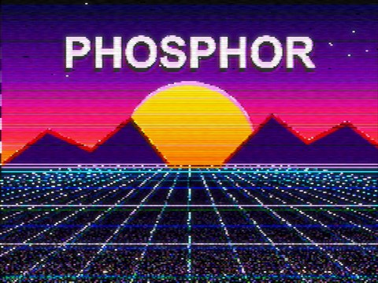
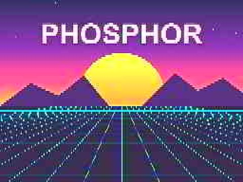
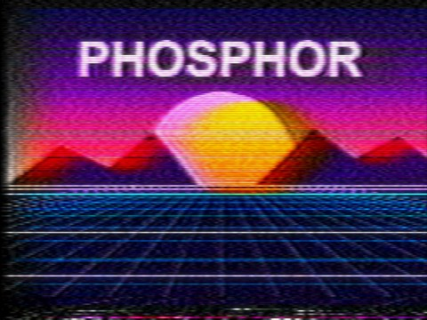
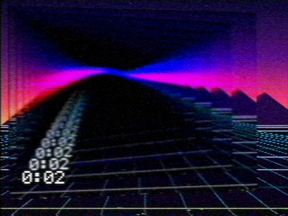

<p align="center">
  
</p>

<h1 align="center">Phosphor</h1>

<p align="center">
  <b>Analog TV, VHS and CRT looks for After Effects, from the camera to the tube.</b><br>
  An After Effects port of <a href="https://github.com/finnmckenty/NTSCRT">NTSCRT</a> by Finn McKenty.
</p>

<p align="center">
  <a href="https://github.com/Alev0000/phosphor/releases/latest"></a>
</p>

<p align="center">
  
  
  
  
</p>

<p align="center">
  
</p>

## What it does

Phosphor runs your layer through a whole analog video chain, in the same order as NTSCRT:

**Digital Video → NTSC / VHS → Downscale → Glitch → CRT**, plus the **Screen Loop**: a camera
filming its own TV.

| Stage | What you get |
|---|---|
| **Digital Video** | A real camera and codec: Webcam, Video call, MiniDV, Early web video, Datamosh. |
| **NTSC (TV)** | The analog signal from [ntsc-rs](https://github.com/ntsc-rs/ntsc-rs): composite noise, color bleed, head switching, tape speed and about sixty more controls. |
| **Downscale** | Retro resolutions (SNES, VGA or your own width), chunky or smooth. |
| **Glitch** | A simulated TV and VCR: weak signal, rolling picture, ghosting, hum, tracking, dropouts. |
| **CRT** | 7 RetroArch shaders: crt-royale, crt-easymode, crt-aperture, crt-hyllian, crtsim, crtglow. |
| **Screen Loop** | The endless video-feedback tunnel, with a draggable vanishing point. |

## Looks

27 ready-made looks from NTSCRT are built in. Pick one from the **Look** menu; animated looks become
After Effects keyframes. Look files open in both Phosphor and NTSCRT.

<table>
  <tr>
    <td align="center"><br><sub>Clean CRT</sub></td>
    <td align="center"><br><sub>Medium VHS</sub></td>
    <td align="center"><br><sub>Glitch 1</sub></td>
  </tr>
  <tr>
    <td align="center"><br><sub>Webcam (low quality)</sub></td>
    <td align="center"><br><sub>Obliterated</sub></td>
    <td align="center"><br><sub>Screen Loop</sub></td>
  </tr>
</table>

## Install

You need Windows 10 or 11 (64-bit) and After Effects. Tested on After Effects 2026; a crash has been
reported on 2024 and is being investigated (see [Crashes](#good-to-know)).

1. **[Download the latest `Phosphor-…-windows.zip`](https://github.com/Alev0000/phosphor/releases/latest)** and unzip it.
2. Close After Effects.
3. Copy the `Phosphor` folder into `C:\Program Files\Adobe\Common\Plug-ins\7.0\MediaCore\` (accept the administrator prompt).
4. Open After Effects: **Effect › Stylize › Phosphor**, then choose a look.

Troubleshooting and more tips: **[README.txt](crates/phosphor-ae/README.txt)** (also inside the zip).

## Good to know

- **Speed:** about 20 ms per 1080p frame for the usual chain on a 12-thread CPU. The CRT and the
  Screen Loop camera run on the GPU (Direct3D 11).
- **Screen Loop** is computed frame by frame, in order: playing forward is fast, jumping to the middle
  of the timeline takes a few seconds to build the tunnel.
- **Same pictures as NTSCRT:** the NTSC stage is ntsc-rs 0.9.4, the version NTSCRT uses, unchanged.
- **Crashes:** if After Effects says *"crash occurred while invoking effect plug-in Phosphor"*, paste
  `%TEMP%\phosphor-ae.log` into File Explorer's address bar and attach that file to an
  [issue](https://github.com/Alev0000/phosphor/issues/new/choose), with your After Effects version.
  Since 0.1.1 the log records what crashed and where, which is usually enough to fix it.
- Problems or ideas: [open an issue](https://github.com/Alev0000/phosphor/issues/new/choose).

## Credits

Phosphor is the glue; the hard parts are other people's work:

- **[NTSCRT](https://github.com/finnmckenty/NTSCRT)** by Finn McKenty: the app Phosphor reproduces, its
  stages, looks and presets (MIT).
- **[ntsc-rs](https://github.com/ntsc-rs/ntsc-rs)** by valadaptive: the NTSC/VHS signal (MIT / ISC / Apache-2.0),
  built on ntscqt, ntsc and composite-video-simulator.
- **[librashader](https://github.com/SnowflakePowered/librashader)** by Ronny Chan, and the
  **[RetroArch shaders](https://github.com/libretro/slang-shaders)** by TroggleMonkey, EasyMode, Hyllian,
  J. Kyle Pittman, Themaister and others.
- **analogtv** by Trevor Blackwell (XScreenSaver): the design behind the Glitch stage.

Full list, with licenses: **[CREDITS.txt](crates/phosphor-ae/CREDITS.txt)**.

> **Vibecoded.** Phosphor was written with AI for an author who is not a programmer, and tested in
> After Effects. It is free and open source, shared as-is. Fixes and improvements are welcome.

## For developers

This repository is a fork of [ntsc-rs](https://github.com/ntsc-rs/ntsc-rs) (its own README:
[NTSC-RS.md](NTSC-RS.md)). Phosphor lives in two crates:

| Folder | What it is |
|---|---|
| [`crates/phosphor-core`](crates/phosphor-core) | The stages, testable outside After Effects (Rust, Direct3D 11). |
| [`crates/phosphor-ae`](crates/phosphor-ae) | The After Effects effect. |

```powershell
cargo test -p phosphor-core --release
cargo build -p phosphor-ae --release   # target\release\phosphor_ae.dll → Phosphor.aex
```

Needs Rust stable, Visual Studio 2022 Build Tools (C++) and LLVM. The CRT shaders are copied from
slang-shaders with `cargo run -p phosphor-core --release --example gen_crt_params -- <slang-shaders> <out\shaders>`.

## License

Phosphor's own code is MIT OR ISC OR Apache-2.0. The parts ported from NTSCRT are under NTSCRT's MIT
license (Copyright (c) 2026 Finn McKenty). ntsc-rs, librashader and the shaders keep their own
licenses; see [CREDITS.txt](crates/phosphor-ae/CREDITS.txt).
